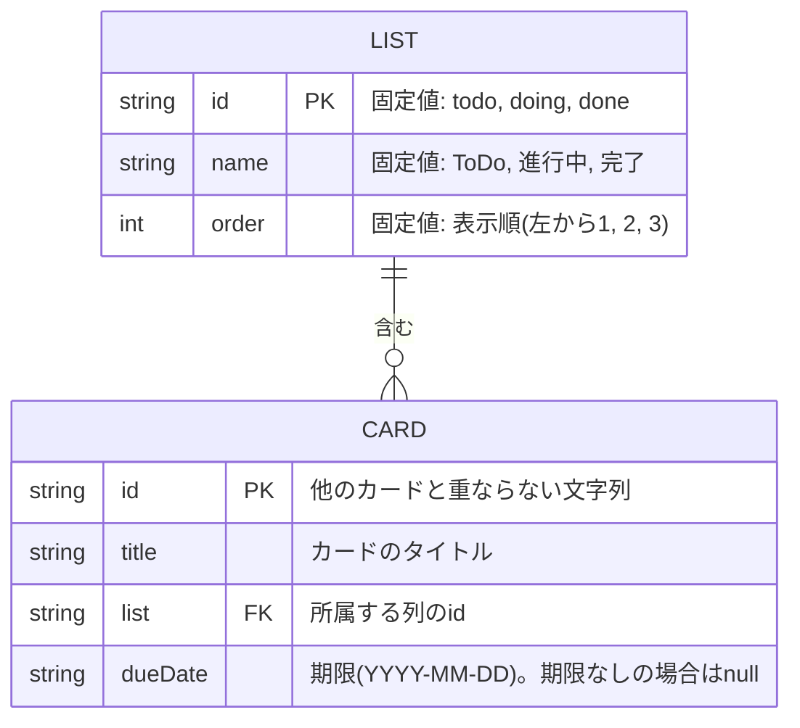
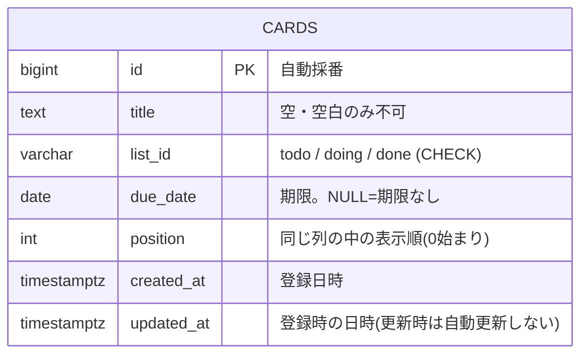

# タスク管理ボード データ保存方式・データ構造

本書は、[REQUIREMENTS.md](./REQUIREMENTS.md)(要件定義書本体)から分割した、データに関する設計である。

## 1. 現状のデータ保存方式

**現行アプリ(`index.html` / `script.js`)は、データベースを使用していない。** サーバーも使わない([REQUIREMENTS.md](./REQUIREMENTS.md) の「3. 制約事項」)。データは、利用者のブラウザの localStorage にだけ保存する(キー名 `kanban-cards`。詳細は「3.1 保存データ(CARD)」)。

本書の「2. ER図」「3. データ定義」は、**現行アプリ(localStorage 版)が持つデータの構造を説明するもの**である。

これとは別に、将来の移行([TECH_STACK.md](./TECH_STACK.md) 第2部)に向けて、PostgreSQL に `cards` テーブルを作成した。**このテーブルは、現行アプリとは連携していない**(現行アプリは localStorage だけを使う)。PostgreSQL の設計は「4. PostgreSQL テーブル設計(cards)」に記載する。

### 実装の状況(2026-11-24 の動作確認終了時点)

| 項目 | 状況 |
|---|---|
| 現行アプリ(localStorage 版) | 変更なし。引き続き localStorage だけを使う |
| PostgreSQL の環境(Docker)、データベース `kanban` | 作成済み |
| `cards` テーブル・制約・インデックスの作成(`db/schema.sql`) | 作成済み |
| SQL の基本操作(INSERT / SELECT / WHERE / DELETE)の確認 | 確認済み(確認用のデータは削除済み) |
| Spring Boot からの `cards` テーブルの参照 | 確認済み(`DatabaseConnectionTest` の4件が成功) |
| `cards` テーブルのデータ件数 | 0件(今回の動作確認終了時点の状態。今後の操作で変わる) |
| REST API | **未実装** |
| フロントエンドとバックエンド(PostgreSQL)の連携 | **未実装** |
| サンプルデータの登録、localStorage のデータの移行 | 未実施 |

---

## 2. ER図(データ構造)【現行: localStorage】

ER図とは、データの種類と、それらの関係を示す図である。この図は、**現行アプリ(localStorage 版)が持つデータの構造を説明するためのもの**である。PostgreSQL の設計は「4. PostgreSQL テーブル設計(cards)」を参照する。

- **CARD(カード)**: 利用者が登録する情報。ブラウザの localStorage に保存される。
- **LIST(列)**: プログラム内に書かれた**固定値**(ToDo・進行中・完了の3つ)。利用者が追加・変更・削除できず、**保存の対象ではない**。



| 関係 | 内容 |
|---|---|
| LIST と CARD | 1つの列は、0枚以上のカードを含む。1枚のカードは、必ず1つの列に所属する |

`LIST` の `name` と `order` は、画面の見出しと表示順を決めるための固定値であり、保存データには含まれない。保存データの中でカードが持つのは、所属する列の `id`(`list` 項目)だけである。

図の「PK」は、他と区別するための項目、「FK」は、別のデータとの関連を示す項目である。

## 3. データ定義【現行: localStorage】

### 3.1 保存データ(CARD)

保存先は、ブラウザの localStorage である。

| 項目 | 内容 |
|---|---|
| 保存のキー名 | `kanban-cards` |
| 保存の形式 | すべてのカードを一覧にして、JSONという文字データの形式で保存する |
| 保存のタイミング | 追加・編集・削除・移動・並べ替え・期限の変更のたび。ただし、ドラッグ&ドロップで元と同じ位置に離した場合は保存しない。アプリを開いたときにも1回保存する |
| カードの並び順 | カードは、内部で1本の並び順(初期は追加した順)で管理される。各列の中の表示順は、この並び順で決まる。ドラッグ&ドロップで移した(並べ替えた)カードは、離した位置の前後のカードの間に入る。列の末尾へ離した場合は、その列の最後に表示される。並び順を表す専用の項目(`order` など)は設けない。保存されるカードの一覧の並びが、そのまま並び順になる。矢印ボタンで移したカードは、並び順を変えず、所属する列だけが変わる |

| 項目名 | 意味 | 型 | 必須 | 値・制約 |
|---|---|---|---|---|
| `id` | カードの識別用の文字 | 文字列 | 必須 | 他のカードと重ならない文字列。アプリが自動で作る(利用者は入力しない) |
| `title` | カードのタイトル | 文字列 | 必須 | 前後の空白を取り除いた文字。画面からの入力では、空にできない。文字数の上限は、実装にはない(**要確認**: 上限を設けるか) |
| `list` | 所属する列 | 文字列 | 必須 | `todo` / `doing` / `done` のいずれか |
| `dueDate` | 期限 | 文字列 または null | 必須(値は null 可) | `YYYY-MM-DD` 形式(例: `2026-11-20`)。期限なしは `null`。過去の日付も指定できる |

「null」は、値がない状態を表す。

その他、実装に上限はないが、仕様として決めていない事項は次のとおり。

| 事項 | 現在の動作 | 状況 |
|---|---|---|
| 1つの列に置けるカード数 | 上限なし | **要確認** |
| 同じタイトルのカード | 複数登録できる | **要確認**(許可してよいか) |
| 保存できるカード数・容量 | ブラウザの localStorage の容量に依存する | **要確認** |

### 3.2 固定値(LIST)

プログラム内に書かれた値であり、保存されない。

| id | 名称 | 表示順(左から) |
|---|---|---|
| `todo` | ToDo | 1 |
| `doing` | 進行中 | 2 |
| `done` | 完了 | 3 |

### 3.3 読み込みと保存のルール

| 場面 | 動作 |
|---|---|
| 保存データがない(初回) | サンプルカードを表示し、そのまま保存する |
| 保存データがある | 保存されたカードを、保存された並び順のまま表示する。カードが0枚(空の一覧)の場合も、空のまま表示する |
| 保存データが壊れている(JSONとして読めない、カードの一覧の形になっていない) | 初回と同じ状態(サンプルカード)から始め、保存し直す。壊れていたデータは失われる |
| 一部のカードの形が正しくない(`id` / `title` が文字列でない、`list` が3つの列のいずれでもない) | 正しいカードだけを読み込む。正しくないカードは、次の保存で失われる |
| `dueDate` がない、または `YYYY-MM-DD` の形でない | 期限なし(`null`)として読み込む。期限が導入される前の保存データも、この扱いで読み込める |
| 保存に失敗した(容量不足・保存禁止など) | アプリは動き続ける。保存はされず、画面には通知されない(ブラウザのコンソールにエラーが出る) |

### 3.4 サンプルデータ(初回に表示するカード)

| タイトル | 列 | 期限 |
|---|---|---|
| サンプル: レポートを書く | ToDo | なし |
| サンプル: 買い物に行く | ToDo | なし |
| サンプル: 課題を進める | 進行中 | なし |
| サンプル: 要件定義を作る | 完了 | なし |

### 3.5 保存データの例

```json
[
  { "id": "m3k9x2a1b2c3d4", "title": "レポートを書く", "list": "todo", "dueDate": "2026-11-20" },
  { "id": "m3k9x2a5e6f7g8", "title": "買い物に行く", "list": "doing", "dueDate": null }
]
```

---

## 4. PostgreSQL テーブル設計(cards)【作成済み・現行アプリとは未連携】

本章は、PostgreSQL に作成した `cards` テーブルの設計である。現行アプリ(「2.」「3.」)は、このテーブルを使っていない。REST API とフロントエンドとの連携は**未実装**である。

テーブルは `cards` の1つだけである。列(todo / doing / done)は固定値のため、テーブルにはせず、`list_id` の CHECK 制約で表す。作成の SQL は [db/schema.sql](./db/schema.sql) にある(実行は手動。既にテーブルがある状態で再実行するとエラーになる)。

### 4.1 カラム定義

| カラム | 型 | NULL | 初期値 | 制約・意味 |
|---|---|---|---|---|
| `id` | BIGINT | 不可 | 自動採番(`GENERATED ALWAYS AS IDENTITY`) | 主キー。カードの識別用の数値 |
| `title` | TEXT | 不可 | なし | 空・空白だけは不可(`btrim(title) <> ''`)。文字数の上限は設けない(上限は**要確認**) |
| `list_id` | VARCHAR(10) | 不可 | なし | `todo` / `doing` / `done` のいずれか(CHECK) |
| `due_date` | DATE | 可 | なし(NULL) | 期限(日付のみ)。NULL は期限なし。過去の日付も入れられる |
| `position` | INTEGER | 不可 | なし | 同じ列の中での表示順(0以上。小さいほど上)。「4.3」参照 |
| `created_at` | TIMESTAMPTZ | 不可 | `now()` | 登録した日時 |
| `updated_at` | TIMESTAMPTZ | 不可 | `now()` | 登録時に初期値が設定される。**更新時には自動で更新されない**(「4.4」参照) |

- インデックス: 主キー `cards_pkey`(`id`)、`idx_cards_list_position`(`list_id`, `position`)。`(list_id, position)` に UNIQUE は付けていない。
- CHECK 制約: `title` が空でない、`list_id` が3値のいずれか、`position` が0以上。

### 4.2 現行アプリ(localStorage)との対応

| 現行(localStorage) | PostgreSQL(cards) | 違い |
|---|---|---|
| `id`(文字列) | `id`(数値、自動採番) | 型が異なる。localStorage の ID は引き継がない前提(移行は未定) |
| `title` | `title` | 同じ |
| `list` | `list_id` | 名前が異なる。値は同じ |
| `dueDate`(`YYYY-MM-DD` または null) | `due_date`(DATE または NULL) | 名前と型が異なる |
| 並び順は、全カードの1本の配列の順 | 列ごとの `position`(0始まりの連番) | 管理方法が異なる |
| なし | `created_at`、`updated_at` | 補助項目。現行の機能にはない |

- 期限切れは**保存しない**。現行と同じ条件(期限あり、かつ「完了」列以外、かつ今日より前)で、表示のたびに判定する。
- 矢印移動の移動先での表示位置は、現行の要件どおり**定めない**(末尾に固定する仕様変更は行わない)。同じ列の中の並べ替えの詳細は、**実装時に改めて確認する**。

### 4.3 `position` の管理(未実装・今後のバックエンドで管理する)

- `position` は、列ごとに 0, 1, 2…と欠番のない連番にする想定である。
- **連番を保つこと、および同じ列で `position` が重複しないことは、データベースでは保証していない**(UNIQUE 制約がないため)。今後のバックエンド(Spring Boot)の実装で、追加・移動・削除のたびに詰め直すなど、アプリ側で管理する。
- 追加・並べ替え・移動・削除の具体的な更新方法は、API の実装時に決める。現時点では未実装である。

### 4.4 `updated_at` の扱い

- 行を登録したとき、`created_at` と `updated_at` には、そのときの時刻が初期値として入る。
- 行を更新(UPDATE)しても、`updated_at` は**自動では変わらない**(自動更新の仕組みは設けていない)。
- 更新時刻を残す場合は、今後のバックエンドの実装で、更新のたびに `updated_at` を設定する。

### 4.5 ER図(PostgreSQL)



### 4.6 データの状況

`cards` テーブルのデータは、**2026-11-24 の動作確認終了時点で0件**である。サンプルデータは登録していない。これは、その時点の状態の記録であり、今後の操作で変わる。
