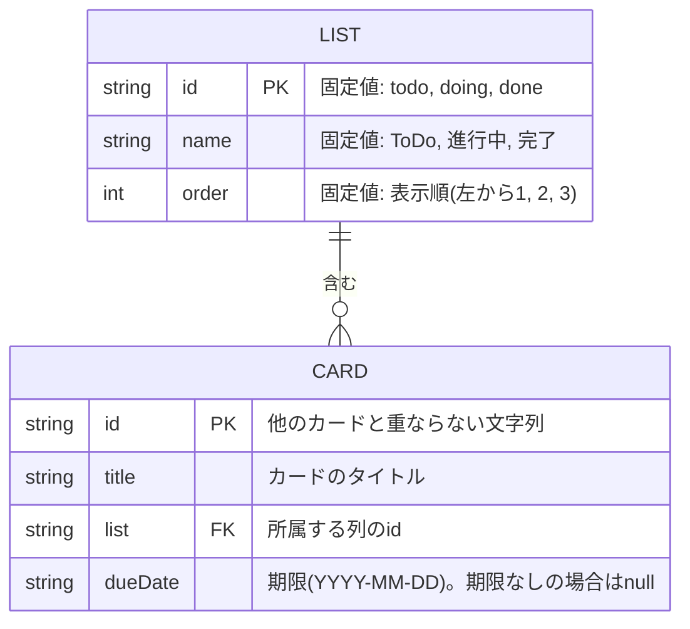

# タスク管理ボード データ保存方式・データ構造

本書は、[REQUIREMENTS.md](./REQUIREMENTS.md)(要件定義書本体)から分割した、データに関する設計である。

## 1. 現状のデータ保存方式

**本アプリはデータベースを使用していない。** サーバーも使わない([REQUIREMENTS.md](./REQUIREMENTS.md) の「3. 制約事項」)。データは、利用者のブラウザの localStorage にだけ保存する(キー名 `kanban-cards`。詳細は「3.1 保存データ(CARD)」)。

このため、テーブル定義・インデックス・SQL などのデータベース設計は存在しない。本書の「2. ER図」「3. データ定義」は、**現在のアプリが持つデータの構造を説明するもの**であり、データベースの導入を意味しない。ファイル名が `DATABASE_DESIGN.md` なのは、文書の分類上の名称である。

---

## 2. ER図(データ構造)

ER図とは、データの種類と、それらの関係を示す図である。この図は、**現在のアプリが持つデータの構造を説明するためのもの**である。データベースを導入するという意味ではない。

- **CARD(カード)**: 利用者が登録する情報。ブラウザの localStorage に保存される。
- **LIST(列)**: プログラム内に書かれた**固定値**(ToDo・進行中・完了の3つ)。利用者が追加・変更・削除できず、**保存の対象ではない**。



| 関係 | 内容 |
|---|---|
| LIST と CARD | 1つの列は、0枚以上のカードを含む。1枚のカードは、必ず1つの列に所属する |

`LIST` の `name` と `order` は、画面の見出しと表示順を決めるための固定値であり、保存データには含まれない。保存データの中でカードが持つのは、所属する列の `id`(`list` 項目)だけである。

図の「PK」は、他と区別するための項目、「FK」は、別のデータとの関連を示す項目である。

## 3. データ定義

### 3.1 保存データ(CARD)

保存先は、ブラウザの localStorage である。

| 項目 | 内容 |
|---|---|
| 保存のキー名 | `kanban-cards` |
| 保存の形式 | すべてのカードを一覧にして、JSONという文字データの形式で保存する |
| 保存のタイミング | 追加・編集・削除・移動・並べ替え・期限の変更のたび。ただし、ドラッグ&ドロップで元と同じ位置に離した場合は保存しない。アプリを開いたときにも1回保存する |
| カードの並び順 | カードは、内部で1本の並び順(初期は追加した順)で管理される。各列の中の表示順は、この並び順で決まる。ドラッグ&ドロップで移した(並べ替えた)カードは、離した位置の前後のカードの間に入る。列の末尾へ離した場合は、その列の最後に表示される。並び順を表す専用の項目(`order` など)は設けない。保存されるカードの一覧の並びが、そのまま並び順になる。矢印ボタンで移したカードは、並び順を変えず、所属する列だけが変わる |

| 項目名 | 意味 | 型 | 必須 | 値・制約 |
|---|---|---|---|---|
| `id` | カードの識別用の文字 | 文字列 | 必須 | 他のカードと重ならない文字列。アプリが自動で作る(利用者は入力しない) |
| `title` | カードのタイトル | 文字列 | 必須 | 前後の空白を取り除いた文字。画面からの入力では、空にできない。文字数の上限は、実装にはない(**要確認**: 上限を設けるか) |
| `list` | 所属する列 | 文字列 | 必須 | `todo` / `doing` / `done` のいずれか |
| `dueDate` | 期限 | 文字列 または null | 必須(値は null 可) | `YYYY-MM-DD` 形式(例: `2026-11-20`)。期限なしは `null`。過去の日付も指定できる |

「null」は、値がない状態を表す。

その他、実装に上限はないが、仕様として決めていない事項は次のとおり。

| 事項 | 現在の動作 | 状況 |
|---|---|---|
| 1つの列に置けるカード数 | 上限なし | **要確認** |
| 同じタイトルのカード | 複数登録できる | **要確認**(許可してよいか) |
| 保存できるカード数・容量 | ブラウザの localStorage の容量に依存する | **要確認** |

### 3.2 固定値(LIST)

プログラム内に書かれた値であり、保存されない。

| id | 名称 | 表示順(左から) |
|---|---|---|
| `todo` | ToDo | 1 |
| `doing` | 進行中 | 2 |
| `done` | 完了 | 3 |

### 3.3 読み込みと保存のルール

| 場面 | 動作 |
|---|---|
| 保存データがない(初回) | サンプルカードを表示し、そのまま保存する |
| 保存データがある | 保存されたカードを、保存された並び順のまま表示する。カードが0枚(空の一覧)の場合も、空のまま表示する |
| 保存データが壊れている(JSONとして読めない、カードの一覧の形になっていない) | 初回と同じ状態(サンプルカード)から始め、保存し直す。壊れていたデータは失われる |
| 一部のカードの形が正しくない(`id` / `title` が文字列でない、`list` が3つの列のいずれでもない) | 正しいカードだけを読み込む。正しくないカードは、次の保存で失われる |
| `dueDate` がない、または `YYYY-MM-DD` の形でない | 期限なし(`null`)として読み込む。期限が導入される前の保存データも、この扱いで読み込める |
| 保存に失敗した(容量不足・保存禁止など) | アプリは動き続ける。保存はされず、画面には通知されない(ブラウザのコンソールにエラーが出る) |

### 3.4 サンプルデータ(初回に表示するカード)

| タイトル | 列 | 期限 |
|---|---|---|
| サンプル: レポートを書く | ToDo | なし |
| サンプル: 買い物に行く | ToDo | なし |
| サンプル: 課題を進める | 進行中 | なし |
| サンプル: 要件定義を作る | 完了 | なし |

### 3.5 保存データの例

```json
[
  { "id": "m3k9x2a1b2c3d4", "title": "レポートを書く", "list": "todo", "dueDate": "2026-11-20" },
  { "id": "m3k9x2a5e6f7g8", "title": "買い物に行く", "list": "doing", "dueDate": null }
]
```
