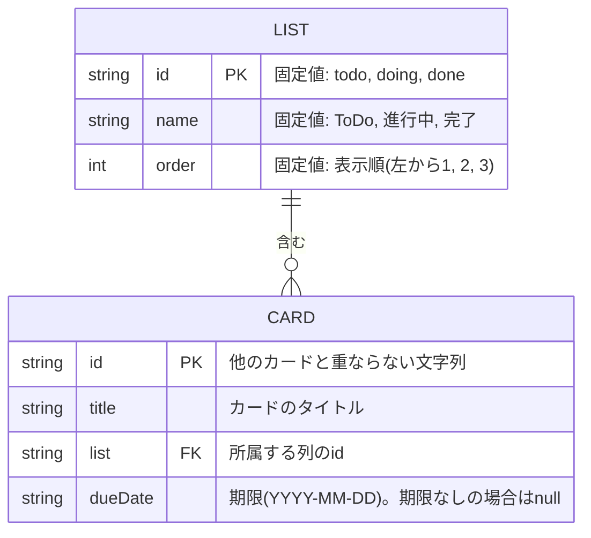

# タスク管理ボード 要件定義書

| 項目 | 内容 |
|---|---|
| 作成目的 | スクール課題(要件定義書の作成) |
| 対象機能 | F1〜F9(9機能) |
| 対象外 | カードの説明文・ラベル・検索、列の編集、ログイン・共有など(詳細は「7. 対象外の機能」) |

## 目次

1. [プロジェクトの目的・背景](#1-プロジェクトの目的背景)
2. [想定ユーザー](#2-想定ユーザー)
3. [解決したい課題](#3-解決したい課題)
4. [システムの概要](#4-システムの概要)
5. [機能要件](#5-機能要件)
6. [非機能要件](#6-非機能要件)
7. [対象外の機能](#7-対象外の機能)
8. [完了条件(受け入れ基準)](#8-完了条件受け入れ基準)
9. [画面一覧](#9-画面一覧)
10. [ユースケース](#10-ユースケース)
11. [ER図(データ構造)](#11-er図データ構造)
12. [データ定義](#12-データ定義)

> 本書で「要確認」と記載した項目は、現在のアプリの仕様として確定できていない、またはお客様との確認が必要な項目である。

---

## 1. プロジェクトの目的・背景

### 背景

本書は、プログラミングスクールの課題として作成する**要件定義書**である。
課題の題材として、Trelloのようなタスク管理ツールを最小限の機能に絞った、個人用のタスク管理ボード(カンバン方式)を取り上げる。

「何を作るか」「何を作らないか」「どうなれば完成か」を、実装の前に文章で明確にすることを、この課題の狙いとする。

### 目的

- ToDo・進行中・完了の3列でタスクを管理できる、シンプルなタスク管理ボードの**要件を整理して文書にまとめる**。
- 機能(F1〜F9)ごとに、**完成したと判断できる基準**を示し、実装後に誰でも同じ手順で確認できるようにする。

## 2. 想定ユーザー

- 自分1人でタスクを管理したい個人
- プログラミングやITツールの専門知識は不要。ブラウザを使えれば操作できる
- 他のユーザーとの共有は想定しない

## 3. 解決したい課題

| 課題 | このアプリでの解決 |
|---|---|
| タスクをメモや頭の中で管理していて、進み具合が分かりにくい | 3列に分けて、状況を一目で確認できる |
| 終わったタスクと、これからのタスクが混ざってしまう | カードを列ごとに移して区別する |
| ブラウザを閉じると記録が消えるツールは使いにくい | ブラウザに自動保存する |
| 高機能なツールは設定が多く、使い始めるまでが大変 | 登録やログインなしで、開けばすぐ使える |

## 4. システムの概要

| 項目 | 内容 |
|---|---|
| 名称 | タスク管理ボード |
| 形態 | Webページ(ブラウザで動く。専用のサーバーは使わない。使用する技術: HTML / CSS / JavaScript) |
| 画面 | 1画面。ToDo・進行中・完了の3つの列が横に並ぶ。各列にカードの追加欄(タイトル・期限)がある |
| カードの情報 | ID(他と重ならない識別用の文字)、タイトル、所属する列、期限(任意) |
| データの保存先 | 利用者自身のブラウザの中(localStorage という、ブラウザに備わった保存の仕組みを使う) |

**使い方の流れ(例)**

1. 「ToDo」の列にカードを追加する(必要なら期限も入力する)
2. 作業を始めたら、矢印ボタンまたはドラッグ&ドロップで「進行中」へ移す
3. 終わったら「完了」へ移す

## 5. 機能要件

対象機能は、次の F1〜F9 の9つである。

| ID | 機能 | 内容 | 補足 |
|---|---|---|---|
| F1 | 3列表示 | 「ToDo」「進行中」「完了」の3列を、左からこの順に表示する | |
| F2 | カード追加 | 列ごとの入力欄にタイトルを入力して追加する。追加したカードは、その列の末尾に表示する。期限も同時に指定できる(F8) | 空欄・空白だけのタイトルは追加しない |
| F3 | カード編集 | 各カードの「編集」ボタンで、タイトルを書き換える | キャンセル・空欄にした場合は変更しない |
| F4 | カード削除 | 各カードの「削除」ボタンで、カードを削除する | 削除前に確認画面(OK / キャンセル)を表示する |
| F5 | 矢印移動 | 各カードの「←」「→」ボタンで、隣の列へ移動する。移動先の列での表示位置は定めない(一番下に表示されるとは限らない) | 一番左の列では「←」、一番右の列では「→」を押せなくする。移動先での表示位置は、カードを追加した順や、ドラッグ&ドロップで移した履歴によって変わる(詳細は12.1)。ドラッグ&ドロップ(F7)では必ず一番下に表示されるため、両者の表示位置は異なる。**要確認**: 矢印移動も、F7と同じく一番下に表示するよう動作を統一するか |
| F6 | データ保存 | カードの追加・編集・削除・移動・期限の変更のたびに、自動で localStorage に保存し、ページを開いたときに復元する | 初回はサンプルカードを表示する。全カードを削除した状態も保存し、空のまま復元する |
| F7 | ドラッグ&ドロップ移動 | カードをマウスでつかんで別の列の上で離すと、その列の末尾へ移動する | 同じ列、または列の外で離した場合は何も変わらない(列内の並び替えはできない)。ドラッグ中は、カードを重ねている列を点線の枠と薄い青の背景で強調し、つかんでいるカードを半透明にする |
| F8 | 期限の設定 | カードの追加時に期限(日付、任意)を指定できる。追加後も、カード上の期限欄で期限の設定・変更ができ、「×」ボタンで削除できる | 期限は日付のみ(時刻はなし)。過去の日付も入力できる。期限がないカードには「×」を表示しない |
| F9 | 期限切れ表示 | 期限が今日より前で、「完了」列以外のカードに「期限切れ」と表示し、赤い左線・薄い赤の背景・赤い文字で強調する | 期限が今日のカードは期限切れにしない。「完了」列のカードは期限切れにしない。今日の日付は、使用中のパソコンの日付で判定する。判定は、ページを開いたとき、またはカードの追加・移動・編集・削除などで画面が描き直されたときに行う。ページを開いたまま日付が変わった場合は、次に画面が描き直されるまで、表示は変わらない。**要確認**: 日付が変わった時点で自動的に更新するか |

## 6. 非機能要件

**表の見方**

- 仕様の状況: 「確定」は、本書の内容で合意する項目。「要確認」は、お客様と決める必要がある項目。
- 実装の確認状況: 「ソース確認済み」は、プログラムの記述で実現されていることを確認した状態。「動作未確認」は、実際にアプリを動かしての確認をこれから行う状態。

| 項目 | 内容 | 仕様の状況 | 実装の確認状況 |
|---|---|---|---|
| 動作環境 | 最新の Chrome / Edge で動作する | 確定。対象OS、ブラウザの具体的なバージョンは**要確認** | 動作未確認 |
| 導入のしやすさ | インストール不要。`index.html` をブラウザで開くだけで使える | 確定 | ソース確認済み / 動作未確認 |
| 操作性 | 初めて使う人でも、説明なしで操作できる | **要確認**(確認方法(何分以内に何ができれば合格か)が未定) | 動作未確認 |
| 安全性 | 入力された文字は、画面にそのままの文字として表示する(入力内容がプログラムとして実行されることはない) | 確定 | ソース確認済み / 動作未確認 |
| 信頼性 | 保存データが壊れていても、アプリは止まらず、初回と同じ状態(サンプルカード)から始まる。保存に失敗しても、アプリは動き続ける | 確定 | ソース確認済み / 動作未確認 |
| データの扱い | データは利用者のブラウザ内だけに保存し、外部には送信しない。別のパソコンや別のブラウザとは共有されない。ブラウザのデータ削除で消える | 確定 | ソース確認済み |
| 保守性 | プログラムを、構造(HTML)・見た目(CSS)・動き(JavaScript)の3つのファイルに分けて管理する | 確定 | ソース確認済み |
| 性能 | 扱えるカード数の目安、表示の速さ | **要確認**(実装にカード数の上限はない) | 動作未確認 |
| 保存容量 | ブラウザの localStorage の容量に依存する。容量を超えると保存に失敗し、画面には通知されない(ブラウザのコンソールにエラーが出る) | 現状の動作は確定。利用者への通知を行うかは**要確認** | ソース確認済み / 動作未確認 |
| バックアップ・移行 | 書き出し・読み込み機能はない。別のパソコンへ引き継ぐ手段は提供しない | 現状は確定。必要かどうかは**要確認** | ソース確認済み |
| アクセシビリティ | ドラッグ&ドロップはマウス操作が前提。同じ移動は、矢印ボタンでも行える | キーボード操作・読み上げ対応などの水準は**要確認** | 動作未確認 |
| 画面サイズ | 列の幅は固定(280px)。パソコンの画面での利用を想定する | 確定。スマートフォン・タブレットは対象外(7章)。ドラッグ&ドロップのタッチ操作は**要確認** | ソース確認済み / 動作未確認 |

## 7. 対象外の機能

今回の課題の範囲では、次の機能は**作らない**。

- カードの説明文、ラベル(色タグ)、検索・絞り込み
- 列の追加・名前変更・削除、複数ボード
- ログイン、複数人での共有・同時編集、通知
- サーバー・データベース
- スマートフォン・タブレット専用の最適化、ダークモード

## 8. 完了条件(受け入れ基準)

下表の全項目が「期待する結果」になれば、完了とする。

| No. | 対応 | 操作 | 期待する結果 |
|---|---|---|---|
| 1 | F1 | ページを開く | 「ToDo」「進行中」「完了」の3列が、左からこの順に表示される |
| 2 | F2 | 入力欄に文字を入れて「追加」を押す(Enterキーでも可) | その列の末尾にカードが表示され、入力欄が空になる |
| 3 | F2 | 何も入力せず、またはスペースだけで「追加」を押す | カードは追加されない |
| 4 | F3 | 「編集」を押し、タイトルを変えてOKを押す | カードのタイトルが新しい文字になる |
| 5 | F3 | 「編集」を押し、キャンセル、または空欄でOKを押す | タイトルは変わらない |
| 6 | F4 | 「削除」を押し、確認でOKを押す | そのカードだけが消える |
| 7 | F4 | 「削除」を押し、確認でキャンセルを押す | カードは残る |
| 8 | F5 | 「→」を押す | 右隣の列に移り、元の列からは消える。(移動先での表示位置は、この項目の確認対象に含めない) |
| 9 | F5 | 「←」を押す | 左隣の列に移り、元の列からは消える |
| 10 | F5 | 一番左の列のカードの「←」、一番右の列のカードの「→」を見る | 押せない状態(薄い表示)になっている |
| 11 | F6 | 追加・編集・移動・削除をして、ページを更新する | 更新前と同じ状態で表示される |
| 12 | F6 | ブラウザを閉じて、開き直す | 最後の状態が復元される |
| 13 | F6 | 保存データがない状態で開く(初回) | サンプルカードが表示される |
| 14 | F6 | すべてのカードを削除して、ページを更新する | 空のまま表示され、サンプルカードは復活しない |
| 15 | 共通 | No.1〜14 の操作を行う | 操作の途中で画面が止まったり、エラーを知らせる表示が出たりしない |
| 16 | F7 | カードをつかんで、別の列の上で離す | カードがその列の末尾に移り、元の列からは消える。ページを更新しても、移動後の状態のままである |
| 17 | F7 | カードをつかんで、同じ列の上、または列の外で離す | カードの所属する列は変わらない |
| 18 | F7 | カードをつかんで、列の上に重ねる(まだ離さない)。そのまま列の外へ出す | カードを重ねている列が、点線の枠と薄い青の背景で強調される。列の外に出ると、強調が消える。つかんでいるカードは半透明で表示される |
| 19 | F8 | 期限欄(追加用)で日付を選び、タイトルを入れて「追加」を押す | カードに期限が表示される。期限欄(追加用)は空に戻る |
| 20 | F8 | 期限を入れずにカードを追加する | カード上の期限欄は空で、「×」ボタンは表示されない |
| 21 | F8 | カード上の期限欄で日付を変更し、ページを更新する | 変更後の日付が表示される |
| 22 | F8 | 期限があるカードの「×」を押す | 期限が消え、「×」ボタンも表示されなくなる |
| 23 | F9 | 「ToDo」の列で、期限欄に**昨日の日付**を選び、タイトルを入れて「追加」を押す | 追加したカードに「期限切れ」と表示され、赤い左線・薄い赤の背景・赤い文字で強調される |
| 24 | F9 | 「ToDo」の列で、期限欄に**今日の日付**を選び、タイトルを入れて「追加」を押す | 「期限切れ」とは表示されない |
| 25 | F9 | No.23 のカードの「→」を2回押して、「完了」の列へ移す | 「期限切れ」の表示と赤い強調が消える(期限の日付は残る) |

**注記**

- No.23〜25 の「昨日」「今日」は、確認を行う日を基準とする。期限欄は、過去の日付も選べる。
- 開発者向けの補足: No.15 の確認と合わせて、ブラウザの開発者ツールのコンソールにエラーが出ていないことも確認する。ただし、保存容量の超過などで保存に失敗した場合は、コンソールにエラーが出る。

## 9. 画面一覧

本アプリの画面は、1画面と、ブラウザが表示する2つのダイアログ(確認や入力のための小さなウィンドウ)である。

| ID | 画面名 | 種類 | 概要 | 関連機能 |
|---|---|---|---|---|
| S1 | タスク管理ボード | 画面 | 3列とカードを表示し、すべての操作を行うメイン画面(`index.html`) | F1〜F9 |
| D1 | タイトル編集ダイアログ | ダイアログ | 「編集」を押したときに表示される。現在のタイトルが入力済みの状態で開く。文言: 「新しいタイトルを入力してください」 | F3 |
| D2 | 削除確認ダイアログ | ダイアログ | 「削除」を押したときに表示される。OK / キャンセルを選ぶ。文言: 「(カードのタイトル)」を削除しますか? | F4 |

D1・D2 は、ブラウザ標準のダイアログである。見た目はブラウザによって異なる。

### S1 の画面構成

```
タスク管理ボード(ヘッダー)

+------------------------+  +------------------------+  +------------------------+
| ToDo                   |  | 進行中                 |  | 完了                   |
|                        |  |                        |  |                        |
| +--------------------+ |  | +--------------------+ |  | +--------------------+ |
| | カード             | |  | | カード             | |  | | カード             | |
| | (期限・ボタン)     | |  | | (期限・ボタン)     | |  | | (期限・ボタン)     | |
| +--------------------+ |  | +--------------------+ |  | +--------------------+ |
|                        |  |                        |  |                        |
| [タイトル][追加]       |  | [タイトル][追加]       |  | [タイトル][追加]       |
| 期限(任意) [日付]      |  | 期限(任意) [日付]      |  | 期限(任意) [日付]      |
+------------------------+  +------------------------+  +------------------------+
```

### S1 の画面項目

| 部品 | 種類 | 内容 | 状態・制約 |
|---|---|---|---|
| 列(ToDo / 進行中 / 完了) | 表示 | 列の見出しと、その列のカードを縦に並べる | 左から ToDo・進行中・完了の順に固定。ドラッグ中は、移動先にできる列を枠と背景色で強調する |
| タイトル入力欄 | テキスト入力 | 新しいカードのタイトルを入力する。入力前の表示は「カードのタイトル」 | 空欄・空白だけでは追加できない |
| 「追加」ボタン | ボタン | カードを列の末尾に追加する | Enterキーでも実行できる。追加後、タイトル欄と期限欄を空にする |
| 期限欄(追加用) | 日付入力 | 新しいカードの期限を選ぶ。見出しは「期限(任意)」 | 未入力でもよい |
| カード | 表示 | タイトル、期限の行、操作ボタンを表示する | マウスでつかんで動かせる。期限切れのカードは赤く強調する |
| カードのタイトル | 表示 | カードのタイトルを表示する | 入力された文字のまま表示する(HTMLとして実行しない) |
| 期限欄(カード上) | 日付入力 | カードの期限を表示・変更する | 変更すると、すぐに保存される |
| 「×」ボタン | ボタン | 期限を削除する。ボタンの説明文は「期限を削除」 | 期限があるときだけ表示する |
| 「期限切れ」表示 | 表示 | 期限切れのカードに表示する | 条件はF9のとおり |
| 「←」ボタン | ボタン | 左の列へ移動する。ボタンの説明文は「左の列へ移動」 | 一番左の列のカードでは押せない(薄く表示) |
| 「→」ボタン | ボタン | 右の列へ移動する。ボタンの説明文は「右の列へ移動」 | 一番右の列のカードでは押せない(薄く表示) |
| 「編集」ボタン | ボタン | タイトル編集ダイアログ(D1)を開く | |
| 「削除」ボタン | ボタン | 削除確認ダイアログ(D2)を開く | 赤い文字で表示する |

画面の配色、フォントなどの見た目の詳細は、本書では定めない。

## 10. ユースケース

利用者は、「自分1人でタスクを管理したい個人」(2章)の1種類のみである。

| UC | 名称 | 利用者の目的 | 対応機能 |
|---|---|---|---|
| UC1 | カードを追加する | やるべきことを登録したい | F2、F8 |
| UC2 | カードのタイトルを編集する | 内容を直したい | F3 |
| UC3 | 矢印ボタンでカードを移動する | 作業の進み具合を更新したい | F5 |
| UC4 | カードを削除する | 不要になったタスクを消したい | F4 |
| UC5 | ドラッグ&ドロップでカードを移動する | 作業の進み具合を、直感的に更新したい | F7 |
| UC6 | 期限を設定・変更・削除する | 締め切りを管理したい | F8 |
| UC7 | 期限切れのカードを確認する | 遅れているタスクに気づきたい | F9 |
| UC8 | 前回の続きから使う | 前回の状態のまま、作業を再開したい | F1、F6 |

### UC1 カードを追加する

| 項目 | 内容 |
|---|---|
| 前提 | ボードを開いている |
| 基本フロー | 1. 追加したい列の入力欄にタイトルを入力する<br>2. 必要なら、期限(任意)を選ぶ<br>3. 「追加」を押す(またはEnterキー)<br>4. その列の末尾にカードが表示される<br>5. タイトルの入力欄と期限欄(追加用)が空に戻る。内容は自動で保存される |
| 例外フロー | タイトルが空欄・空白だけの場合は、何も追加されない |

### UC2 カードのタイトルを編集する

| 項目 | 内容 |
|---|---|
| 前提 | 編集したいカードが表示されている |
| 基本フロー | 1. 「編集」を押す<br>2. タイトル編集ダイアログ(D1)に、現在のタイトルが表示される<br>3. 新しいタイトルを入力してOKを押す<br>4. カードのタイトルが変わる。内容は自動で保存される |
| 例外フロー | キャンセルを押した場合、またはタイトルを空欄にしてOKを押した場合は、変更されない |

### UC3 矢印ボタンでカードを移動する

| 項目 | 内容 |
|---|---|
| 前提 | 移動したいカードが表示されている |
| 基本フロー | 1. 「←」または「→」を押す<br>2. カードが隣の列へ移る。移動先での表示位置は定めない(F5のとおり)。内容は自動で保存される |
| 例外フロー | 一番左の列の「←」、一番右の列の「→」は押せない |

### UC4 カードを削除する

| 項目 | 内容 |
|---|---|
| 前提 | 削除したいカードが表示されている |
| 基本フロー | 1. 「削除」を押す<br>2. 削除確認ダイアログ(D2)が表示される<br>3. OKを押す<br>4. カードが消える。内容は自動で保存される |
| 例外フロー | キャンセルを押した場合は、カードは残る |

### UC5 ドラッグ&ドロップでカードを移動する

| 項目 | 内容 |
|---|---|
| 前提 | 移動したいカードが表示されている |
| 基本フロー | 1. カードをマウスでつかんで動かす<br>2. 列の上に来ると、その列が強調表示される<br>3. 移動したい列の上で、マウスを離す<br>4. カードがその列の末尾へ移る。内容は自動で保存される |
| 例外フロー | 同じ列の上、または列の外で離した場合は、何も変わらない |

### UC6 期限を設定・変更・削除する

| 項目 | 内容 |
|---|---|
| 前提 | ボードを開いている(設定・変更・削除の場合は、対象のカードが表示されている) |
| 基本フロー | 設定(追加時): UC1 の手順2で期限を選ぶ<br>設定・変更(追加後): カード上の期限欄で日付を選ぶ。選んだ時点で保存される<br>削除: カードの「×」を押す。期限が消え、保存される |
| 例外フロー | 期限欄の入力を消して空にした場合も、期限なしになる |

### UC7 期限切れのカードを確認する

| 項目 | 内容 |
|---|---|
| 前提 | 期限が設定されたカードがある |
| 基本フロー | 1. ボードを開く(または期限を変更する)<br>2. 「ToDo」「進行中」の列で、期限が今日より前のカードに「期限切れ」と表示され、赤く強調される |
| 例外フロー | 期限が今日のカードは、期限切れにならない。「完了」列のカードは、期限が過ぎていても期限切れにならない。ページを開いたまま日付が変わった場合は、次に画面が描き直されるまで、表示は変わらない |

### UC8 前回の続きから使う

| 項目 | 内容 |
|---|---|
| 前提 | 同じブラウザで、以前にボードを使ったことがある |
| 基本フロー | 1. ボードを開く<br>2. 前回の最後の状態で、カードが表示される |
| 例外フロー | 初回(保存データがない場合)は、サンプルカードが表示される<br>すべてのカードを削除した状態で閉じた場合は、空のまま表示される<br>保存データが壊れている場合は、初回と同じ状態(サンプルカード)から始まる |
| 注意事項 | 別のパソコン、別のブラウザ、またはブラウザのデータを削除した後は、前回の状態を見られない |

## 11. ER図(データ構造)

ER図とは、データの種類と、それらの関係を示す図である。この図は、**現在のアプリが持つデータの構造を説明するためのもの**である。データベースを導入するという意味ではない。

- **CARD(カード)**: 利用者が登録する情報。ブラウザの localStorage に保存される。
- **LIST(列)**: プログラム内に書かれた**固定値**(ToDo・進行中・完了の3つ)。利用者が追加・変更・削除できず、**保存の対象ではない**。



| 関係 | 内容 |
|---|---|
| LIST と CARD | 1つの列は、0枚以上のカードを含む。1枚のカードは、必ず1つの列に所属する |

`LIST` の `name` と `order` は、画面の見出しと表示順を決めるための固定値であり、保存データには含まれない。保存データの中でカードが持つのは、所属する列の `id`(`list` 項目)だけである。

図の「PK」は、他と区別するための項目、「FK」は、別のデータとの関連を示す項目である。

## 12. データ定義

### 12.1 保存データ(CARD)

保存先は、ブラウザの localStorage である。

| 項目 | 内容 |
|---|---|
| 保存のキー名 | `kanban-cards` |
| 保存の形式 | すべてのカードを一覧にして、JSONという文字データの形式で保存する |
| 保存のタイミング | 追加・編集・削除・移動・期限の変更のたび。アプリを開いたときにも1回保存する |
| カードの並び順 | カードは、内部で1本の並び順(カードを追加した順)で管理される。各列の中の表示順は、この並び順で決まる。ドラッグ&ドロップで移したカードは、最後に追加されたものとして並び順の末尾に移る。矢印ボタンで移したカードは、並び順を変えず、所属する列だけが変わる |

| 項目名 | 意味 | 型 | 必須 | 値・制約 |
|---|---|---|---|---|
| `id` | カードの識別用の文字 | 文字列 | 必須 | 他のカードと重ならない文字列。アプリが自動で作る(利用者は入力しない) |
| `title` | カードのタイトル | 文字列 | 必須 | 前後の空白を取り除いた文字。画面からの入力では、空にできない。文字数の上限は、実装にはない(**要確認**: 上限を設けるか) |
| `list` | 所属する列 | 文字列 | 必須 | `todo` / `doing` / `done` のいずれか |
| `dueDate` | 期限 | 文字列 または null | 必須(値は null 可) | `YYYY-MM-DD` 形式(例: `2026-11-20`)。期限なしは `null`。過去の日付も指定できる |

「null」は、値がない状態を表す。

その他、実装に上限はないが、仕様として決めていない事項は次のとおり。

| 事項 | 現在の動作 | 状況 |
|---|---|---|
| 1つの列に置けるカード数 | 上限なし | **要確認** |
| 同じタイトルのカード | 複数登録できる | **要確認**(許可してよいか) |
| 保存できるカード数・容量 | ブラウザの localStorage の容量に依存する | **要確認** |

### 12.2 固定値(LIST)

プログラム内に書かれた値であり、保存されない。

| id | 名称 | 表示順(左から) |
|---|---|---|
| `todo` | ToDo | 1 |
| `doing` | 進行中 | 2 |
| `done` | 完了 | 3 |

### 12.3 読み込みと保存のルール

| 場面 | 動作 |
|---|---|
| 保存データがない(初回) | サンプルカードを表示し、そのまま保存する |
| 保存データがある | 保存されたカードを表示する。カードが0枚(空の一覧)の場合も、空のまま表示する |
| 保存データが壊れている(JSONとして読めない、カードの一覧の形になっていない) | 初回と同じ状態(サンプルカード)から始め、保存し直す。壊れていたデータは失われる |
| 一部のカードの形が正しくない(`id` / `title` が文字列でない、`list` が3つの列のいずれでもない) | 正しいカードだけを読み込む。正しくないカードは、次の保存で失われる |
| `dueDate` がない、または `YYYY-MM-DD` の形でない | 期限なし(`null`)として読み込む。期限が導入される前の保存データも、この扱いで読み込める |
| 保存に失敗した(容量不足・保存禁止など) | アプリは動き続ける。保存はされず、画面には通知されない(ブラウザのコンソールにエラーが出る) |

### 12.4 サンプルデータ(初回に表示するカード)

| タイトル | 列 | 期限 |
|---|---|---|
| サンプル: レポートを書く | ToDo | なし |
| サンプル: 買い物に行く | ToDo | なし |
| サンプル: 課題を進める | 進行中 | なし |
| サンプル: 要件定義を作る | 完了 | なし |

### 12.5 保存データの例

```json
[
  { "id": "m3k9x2a1b2c3d4", "title": "レポートを書く", "list": "todo", "dueDate": "2026-11-20" },
  { "id": "m3k9x2a5e6f7g8", "title": "買い物に行く", "list": "doing", "dueDate": null }
]
```
