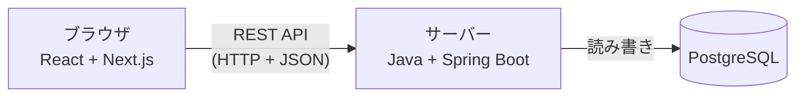

# タスク管理ボード 技術スタック

本書は、[REQUIREMENTS.md](./REQUIREMENTS.md)(要件定義書本体)から分割した、使用技術とその役割の整理である。内容は、既存の要件定義書の記載と、現在のソースコード(`index.html` / `style.css` / `script.js`)で確認できる事実に限る。

> **本書の読み方**
> - **第1部(1〜3章)【現行】**: 今動いているアプリ(HTML / CSS / JavaScript)の、確認済みの事実を記載する。
> - **第2部(4〜9章)【予定】**: 将来の移行を予定している新しい技術構成の計画。**まだ実装していない。** 動作の確認もしていない。
> - 【現行】と【予定】は、見出しの表記で区別する。第2部の記述は「〜する予定」「〜を想定」であり、実現を保証するものではない。
> - 現行の「サーバー・データベースは使わない」という制約([REQUIREMENTS.md](./REQUIREMENTS.md) の「3. 制約事項」)は、移行を実施する際に見直す。この制約は現時点では変更していない。

## 1. 使用技術と役割

| 技術 | 役割 | ファイル |
|---|---|---|
| HTML | 画面の構造(ヘッダー、3つの列、カード追加の入力欄)を定義する | `index.html` |
| CSS | 画面の見た目(列の幅、カードの強調表示など)を定義する | `style.css` |
| JavaScript | カードの追加・編集・削除・移動、期限切れ判定、保存と読み込みなど、画面の動きを実装する | `script.js` |
| localStorage(ブラウザ標準の保存機能) | カードのデータを、利用者のブラウザ内に保存する(キー名 `kanban-cards`)。詳細は [DATABASE_DESIGN.md](./DATABASE_DESIGN.md) | (ブラウザ) |
| ブラウザ標準のダイアログ(`prompt` / `confirm`) | タイトル編集(D1)と削除確認(D2)に使う。詳細は [SCREEN_DESIGN.md](./SCREEN_DESIGN.md) | `script.js` |
| ブラウザ標準のドラッグ&ドロップ機能 | カードをマウスでつかんで、同じ列・別の列の好きな位置へ移動・並べ替える(F7) | `script.js` |

## 2. 構成

- 形態: Webページ。ブラウザで動き、専用のサーバーは使わない。
- 保守性: 構造(HTML)・見た目(CSS)・動き(JavaScript)の3つのファイルに分けて管理する。
- 導入: インストール不要。`index.html` をブラウザで開くだけで使える。
- フレームワーク・ライブラリ・ビルド作業: 使用していない(`index.html` が読み込むのは `style.css` と `script.js` のみ)。
- データベース: 使用していない(現行アプリ。PostgreSQL の `cards` テーブルは別途作成済みだが、現行アプリとは未連携。第2部を参照)。

## 3. 動作環境

- 最新の Chrome / Edge で動作する。対象OS、ブラウザの具体的なバージョンは**要確認**([REQUIREMENTS.md](./REQUIREMENTS.md) の「2. 非機能要件」)。
- 列の幅は固定(280px)で、パソコンの画面での利用を想定する。

---

# 第2部 将来の移行予定【予定】

> 本部は計画であり、未実装・未検証である。現行のアプリ(第1部)は、移行後もそのまま残す予定である。

## 4. 採用予定の技術スタックと役割【予定】

| 技術 | 役割 | たとえ(レストラン) | 現行での対応物 |
|---|---|---|---|
| React | 画面を「部品(コンポーネント)」で組み立てるライブラリ。列・カード・追加フォームを部品にする予定 | 盛り付け | `script.js` の `render()`(画面の描き直し) |
| Next.js | React を使いやすくする枠組み。ページの管理、開発用サーバー、公開用の変換(ビルド)を担う | 店の設計図 | `index.html`(ブラウザで直接開く方式) |
| Java + Spring Boot | サーバー側のプログラム。REST API の提供、入力チェック(空のタイトルの拒否など)、データベースの読み書きを担う | 厨房 | なし(現行はブラウザ内で完結) |
| REST API | 画面とサーバーが、HTTP(ウェブの通信の約束)と JSON(文字データの形式)でやり取りする方式。URL で対象を表し、GET・POST・PATCH・DELETE などの HTTP メソッド(操作の種類)で操作を区別する(例: 同じ `/api/cards` でも、GET は一覧の取得、POST は追加) | 注文票 | なし |
| PostgreSQL | データを長期的に保存するデータベース。`cards` テーブルを作成済み(Spring Boot からの参照を確認済み)。現行アプリ・REST API からは未使用 | 倉庫 | localStorage(キー名 `kanban-cards`) |

用語: **API** は、プログラム同士がやり取りするための窓口。**データベース**は、データを整理して保存し、探したり更新したりするための仕組み。

## 5. 選定理由【予定】

| 技術 | 選定理由 |
|---|---|
| 技術スタック全体 | 講義で指定された技術である。「画面 → API → データベース」という、一般的なWebアプリの構成を学べる |
| React | 現行の「データを変更 → 画面を描き直す」という考え方を、そのまま部品単位で書き直せる |
| Next.js | React の開発に必要な土台が揃っており、初期設定が少なくて済む |
| Java + Spring Boot | Java で広く使われるWebフレームワーク。API の作成、入力チェック、データベース接続の機能が揃っている |
| REST API | URL で対象を表し、HTTP メソッドで操作を区別するため、初心者にも分かりやすい。画面とサーバーを別々に開発・確認できる |
| PostgreSQL | 無償で広く使われるデータベース。データをブラウザの外に保存でき、現行の課題(同じブラウザでしかデータを見られない)を解決する基盤になる |

**注意点(デメリット)**: 構成要素が増えるため、学習量と環境構築の手間が現行より大きくなる。現行は `index.html` を開くだけで使えたが、新構成では、サーバーとデータベースを起動する必要がある。

## 6. 予定構成の全体像と現行との比較【予定】

| 項目 | 現行【現行】 | 予定【予定】 |
|---|---|---|
| 形態 | ブラウザだけで動く | ブラウザ + サーバー + データベース |
| データの保存先 | ブラウザの localStorage | PostgreSQL |
| データの共有 | 同じパソコンの同じブラウザのみ | 条件を満たせば、別のパソコン・別のブラウザからも同じデータを利用できる(下記) |
| 導入 | `index.html` を開くだけ | JDK・Node.js・PostgreSQL などの導入と、サーバーの起動が必要 |

### 別の端末からデータを利用するための条件

PostgreSQL に保存するだけでは、別の端末からデータは見えない。次の条件が必要である。

- **サーバー(Spring Boot と PostgreSQL)が起動しており、別の端末から通信できること。** ブラウザは PostgreSQL に直接つながらず、Spring Boot の REST API を経由する。
- **別の端末から、サーバーへ接続できるネットワーク環境があること。**
  - `localhost` は、その端末自身を指す。開発用パソコン1台でサーバーを動かして `localhost` で接続する場合、データを利用できるのはそのパソコンだけである。別の端末から利用するには、サーバーの待ち受け設定(外部からの接続を受け付ける設定)やネットワーク設定が必要である。
  - 同じ家庭内・社内のネットワーク(LAN)の別端末から使うには、上記に加えて、ファイアウォールなどの調整が必要である。
  - インターネット越しに使うには、サーバーを公開するクラウド等の環境が必要であり、本計画の範囲外である。
- 現行の要件にはログイン機能がない。ネットワークに公開する場合は、第三者にデータを見られない対策が別途必要になる(未決事項に記載)。

## 7. 開発環境の予定【予定】

| 道具 | 候補・採用 | 用途 | 現在の導入状況(2026-11-24 確認) |
|---|---|---|---|
| JDK | 25(LTS)。`backend/build.gradle.kts` が Java 25 を指定 | Spring Boot の実行 | 導入済み(`java -version`: Eclipse Temurin 25.0.5.1) |
| ビルドツール | **Gradle**(Gradle Wrapper。Spring Boot 4.0.10) | Java の部品管理・ビルド | 導入済み(`./gradlew --version`: Gradle 9.9.2) |
| Node.js | LTS 版 | Next.js / React の実行 | 未導入(`node` コマンドが見つからない) |
| PostgreSQL | 16 以降 | データベース | Docker で導入済み(`postgres:16`、PostgreSQL 16.16。コンテナ `kanban-db`) |
| Git | — | 履歴管理 | 導入済み |
| エディタ | VS Code | 開発 | 要確認 |
| 動作確認用 | ブラウザの開発者ツール、curl または Postman | API の確認 | 要確認 |

バージョンは候補であり、確定値ではない。着手時に、公式サイトで最新の対応状況を再確認する。環境構築は、本書の改訂では行わない。

## 8. 移行の段階的計画【予定】

各段階で動作を確認してから、次へ進む。

| Step | 内容 | 確認方法 | 状況(2026-11-24 時点) |
|---|---|---|---|
| 0 | 設計の確定(API の一覧、データベースの表の案、見直す文書の範囲) | 設計書のレビュー | テーブル設計は済([DATABASE_DESIGN.md](./DATABASE_DESIGN.md) の「4.」)。API の一覧は未作成 |
| 1 | 環境構築(JDK・Node.js・PostgreSQL を導入) | 各バージョンの表示、データベースへの接続 | JDK・PostgreSQL は済。Node.js は未導入 |
| 2 | Spring Boot の雛形を作成し、データベースへ接続 | アプリが起動し、接続エラーが出ない | 済(接続テスト、`cards` テーブルの参照テストが成功) |
| 3 | REST API を実装(一覧 → 追加 → 編集・移動 → 削除 → 並べ替え) | curl で、正常な場合と異常な場合(空のタイトルなど)を確認 | 一部。`cards` テーブルの作成と参照確認のみ済。**REST API は未実装** |
| 4 | Next.js の雛形を作成し、API と通信 | 画面から API の応答を取得できる | 未着手 |
| 5 | 画面を移植(表示 → 追加 → 編集・削除 → 矢印移動 → 期限 → ドラッグ&ドロップ) | 機能ごとに、現行アプリと挙動を比較 | 未着手 |
| 6 | 現行の localStorage のデータを引き継ぐか判断(任意) | 判断結果の記録 | 未着手 |
| 7 | 受け入れ確認 | [FUNCTIONAL_REQUIREMENTS.md](./FUNCTIONAL_REQUIREMENTS.md) の No.1〜29 を新アプリで実施 | 未着手 |
| 8 | 関連文書の更新(REQUIREMENTS / DATABASE_DESIGN / README)と、現行アプリの扱いの決定 | 文書の整合確認 | 一部(DB層の状況を各文書に反映)。REST API・画面連携後に再更新する |

- **フォルダ配置案**: 現行のファイルは移動せず、`backend/`(Spring Boot)と `frontend/`(Next.js)を新しく作って並べる。`backend/` は作成済み。`frontend/` は未作成。
- データベースの表の設計(並び順を保存する `position` 列を含む)は、[DATABASE_DESIGN.md](./DATABASE_DESIGN.md) の「4.」に記載した。API の詳細は未作成で、別の設計書で扱う。本書には書かない。

## 9. 未決事項(要確認)【予定】

| 項目 | 内容 |
|---|---|
| ビルドツール | **Gradle に決定**(実装済みの `backend/build.gradle.kts` に合わせた) |
| フロントの言語 | JavaScript か TypeScript か |
| PostgreSQL の導入方法 | **Docker(docker-compose.yml)に決定**(2026-11-22)。起動手順は [README.md](./README.md) |
| 既存データの引き継ぎ | localStorage のデータを移行するか |
| 別端末からの利用範囲 | 開発用パソコンのみ / LAN内 / インターネット公開のどれを目指すか |
| 公開時の安全対策 | ログイン機能の要否(現行の要件にはない) |
| REQUIREMENTS.md の制約 | 「サーバー・データベースは作らない」の見直し時期 |
| 各ツールのバージョン | 着手時に確定する |
